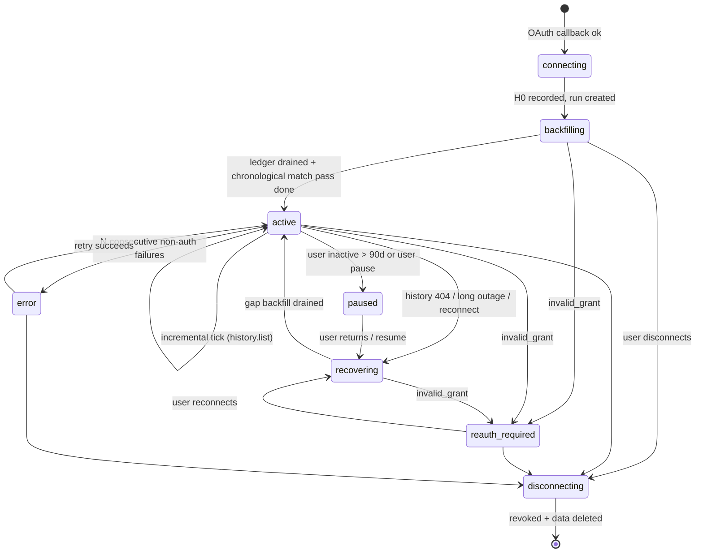

# 5–6. OAuth, Gmail Integration and Synchronization

Labels: [F] fact checked against official docs on 2026-10-11 · [F-ref] from the API reference, re-verify · [A] assumption · [D] decision.

---

## 5. OAuth and Gmail integration

### 5.1 Two separate flows

| | **Sign-in** | **Connect mailbox** |
|---|---|---|
| Purpose | Create or identify the app user. | Authorise background reading of one Gmail mailbox. |
| Scopes | `openid email profile` | `openid email https://www.googleapis.com/auth/gmail.readonly` |
| Key params | `response_type=code`, `state`, `nonce`, PKCE `S256` | Same, plus `access_type=offline`, `prompt=consent`, `include_granted_scopes=false` |
| Stored | `sub`, email, name. **No Google tokens are kept** (the access token is discarded). | Google `sub` of the mailbox, address, **encrypted refresh token**, granted scopes. |
| Sensitivity | Non-sensitive scopes | **Restricted** scope [F] |

**Flow details [D]:**

- **Confidential web client.** The authorization-code exchange happens server-side with the client secret. We also use PKCE (S256), which defends against code interception and injection. `state` is a random 256-bit value. It is stored server-side in `oauth_flows` together with the session ID, purpose (`login` or `connect`), PKCE verifier and nonce, and expires after 10 minutes. It is single-use.
- **ID token validation.** Check `iss`, `aud`, `exp` and `nonce`, and require `email_verified=true`. Identify users by **`sub`, never by email address**, because email addresses can change.
- **Connect callback checks:**
  1. Find the `state` row and confirm it belongs to the current session and has purpose `connect`.
  2. Exchange the code.
  3. **Check the `scope` field** of the token response. With granular consent, users can untick Gmail. If `gmail.readonly` is missing, show a "Gmail permission wasn't granted" screen with a retry button [F: the OAuth guide says to compare granted scopes and disable features that depend on scopes the user didn't grant].
  4. Require a `refresh_token`. `prompt=consent` makes Google issue one even on reconnect.
  5. Call `users.getProfile` to get `emailAddress` and `historyId`.
  6. Upsert `mail_accounts` keyed by `(provider, provider_subject)`.
     - If the mailbox is already linked to *another* app user, reject with `MAILBOX_LINKED_ELSEWHERE`.
     - If it is linked to the *same* user (reconnect), replace the credentials and run gap recovery (§6.5).
  7. Encrypt and store the refresh token. Queue `account.backfill`.
- **The connected mailbox may be a different Google account from the sign-in account.** This is how multiple accounts work. Pass `login_hint` only when reconnecting a known account.
- **One OAuth client ID** for both flows [D]. Revoking the mailbox grant also removes the client's basic scopes. That's harmless, because sign-in never depends on stored Google tokens. The alternative, two clients, adds configuration for no real benefit.

### 5.2 Token lifecycle

| Event | Handling |
|---|---|
| Access token (about 1 hour, see `expires_in`) | Cached **in worker memory only**, per account, refreshed 5 minutes before expiry or on a 401. Never stored in the database or logs. |
| Refresh response contains a new `refresh_token` | Replace the stored one atomically, with a new data key. |
| `invalid_grant` on refresh | Account becomes `reauth_required`. Stop scheduling, show a banner, send email (later). Causes [F]: user revoked access; password changed (when the token has Gmail scopes); unused for 6 months; Testing-mode 7-day expiry; more than 100 refresh tokens per account per client (oldest silently invalidated); time-based access expired. |
| Transient error (5xx or network) | Retry with backoff. Don't change the account state until the account-level failure policy triggers (§6.8). |
| Reconnect | A new refresh token replaces the old one. Never keep several. This also avoids hitting the 100-token limit. |
| Disconnect | Revoke via `POST https://oauth2.googleapis.com/revoke` (best effort, then delete locally either way). Stop `watch` if push is on. Delete credentials. |
| Account paused (inactive user) | Refresh tokens die after 6 months unused [F]. On return, the user reconnects, followed by gap recovery. |

**Storage [D]: envelope encryption.**
- A per-row data key (AES-256-GCM) encrypts the refresh token.
- The data key is wrapped by a key-encryption key in **Cloud KMS**. For local development and early beta, a master key from the environment with a `key_id` works.
- AAD = `mail_account_id`, so a ciphertext can't be moved to another row.
- Credentials live in a separate table (`mail_account_credentials`). Only the worker's token module reads it. The API process only writes it, at connect time.
- Rotating the KMS key means rewrapping data keys. The tokens themselves are never decrypted in bulk.

### 5.3 Consent experience

1. **Pre-consent explainer** (our page, shown before Google's screen):
   - What we read: emails that look job-related, within the import window.
   - What we store: company, role, dates, status, a short snippet and an "Open in Gmail" link.
   - What we never do: send, delete or modify email; sell data; show your email to people; use it for advertising; train AI models on it.
   - How to disconnect and delete.
   - A note that Google's screen will say "View your email messages and settings". We must not downplay this: read-only access is still access to the whole mailbox.
2. Google consent screen. In Testing mode or while unverified, Google also shows an unverified-app warning. Explain this to beta users.
3. Return to the import progress screen.

### 5.4 Google verification and security assessment

- `gmail.readonly` and `gmail.metadata` are both **restricted** [F]. `gmail.labels` is non-sensitive but useless for our purpose.
- Restricted-scope verification needs:
  - A privacy policy that discloses access, use, storage and sharing, and complies with the **Limited Use** requirements.
  - Domain and brand verification.
  - A scope justification and a demo video [F; the video is A, as is common practice].
- **CASA security assessment** by a Google-approved assessor is required when restricted data is reachable from or through our servers. It must be redone **at least every 12 months** [F]. Cost and tier depend on the assessor and on Google's tiering; get quotes [A].
- **Exemptions** [F]: personal use or a few known users (with a user cap), development, testing and staging projects, and internal Workspace-only apps.
- **Testing mode**: refresh tokens expire in 7 days unless only basic scopes are requested [F]. There is a test-user cap of 100 [A, the standard cap].
- **Limited Use and Workspace user-data policy** [F]:
  - Use data only to provide or improve the user-facing feature.
  - **No human reading**, except with the user's documented consent, for security investigations, for legal compliance, or for aggregated, anonymised internal operations.
  - No transfers except for user-consented feature delivery, security or law.
  - **No creating, training or improving AI/ML models** beyond that specific user's personalised model.

**Plan [D]:** beta in Testing mode (at most 100 users, weekly reconnect). From phase 0 onwards, prepare the verification artefacts and CASA evidence: SAST and dependency scanning in CI, encryption, access control, logging policy, deletion. Apply when you decide to go public.

---

## 6. Synchronization

### 6.1 Core concepts

| Concept | Definition |
|---|---|
| **Message ledger** (`source_messages`) | One row per `(mail_account_id, provider_message_id)`. The single source of idempotency. A message is discovered, then fetched, then classified, then extracted, then matched (or skipped or failed). |
| **Checkpoint** | Gmail `historyId`, stored as text and compared numerically (uint64). It moves forward only, and only together with the ledger rows it covers, in one transaction. |
| **Lease** | At most one sync worker per account. Implemented as a row lease with an incrementing **fencing token** (`lease_version`). |
| **Run** | One `sync_runs` row per backfill, incremental sync, gap recovery or reprocess. It holds counters and cursors for progress and resumption. |
| **Per-user match lock** | Matching for a user is serialised, because applications belong to the user, not the account. Two accounts can deliver emails about the same application at the same moment. |

Gmail facts that drive the design:
- Full sync uses `messages.list`, then batched `messages.get`. Store the newest `historyId`. Partial sync uses `history.list(startHistoryId)` [F].
- History is kept "at least a week, often longer", but **can be much shorter**. An expired start ID returns **HTTP 404**, after which a full sync is required [F].
- Quota costs [F]:
  - Per project: 1,200,000 units/min.
  - **Per user: 6,000 units/min**.
  - `messages.get` = **20**, `messages.list` = 5, `history.list` = 2, `threads.get` = 40, `watch` = 100.
- So one mailbox can do **at most 300 `messages.get` calls a minute**. We budget **≤ 4,500 units/min (75%)**, which is about 225 fetches a minute, per account.
- The batch HTTP endpoint saves round trips but not quota. Keep batches at **50 calls or fewer** [A: per Google's batch guidance; re-verify].
- Gmail message IDs are stable within a mailbox but **differ across mailboxes**. Cross-account deduplication therefore uses the RFC 5322 `Message-ID` header plus a content fingerprint (§8.7).

### 6.2 Account sync state machine



`error` is shown to the user with a reason code. Retries continue on a long backoff (§6.8).

### 6.3 Initial synchronization (backfill)

**Why bounded rather than a full scan [D].** A student mailbox commonly holds 10,000–100,000+ messages. A full scan at 225 fetches a minute takes hours per account. It also downloads personal mail we have no reason to see, which works against minimisation and CASA. A bounded window (default 6 months, user-configurable 1–12) using candidate queries usually covers 300–3,000 messages [A]. The user can extend backward later ("Import older emails"). That runs another bounded backfill for `[new_start, old_start)`. The ledger skips anything already processed.

**Step 0: anchor the checkpoint *before* scanning.**
```
H0 = users.getProfile().historyId
sync_state.checkpoint = H0     (in the same transaction that creates the run)
```
Incremental sync can start **immediately** from H0, in parallel with the backfill. Anything that arrives during a long import is caught by history sync. Anything caught by both paths is deduplicated by the ledger's unique key. This is how we avoid missing messages during the import.

**Step 1: enumerate candidate IDs (cheap: 5 units per page of up to 500 IDs).**

Run several versioned query families, each bounded by `after:<window_start_epoch>`. `includeSpamTrash=false` is the default.

| Family | Purpose | Example `q` (illustrative; tuned against the corpus) |
|---|---|---|
| Q-reg | Known recruiting senders from the registry | `from:(greenhouse.io OR lever.co OR myworkday.com OR myworkdayjobs.com OR smartrecruiters.com OR icims.com OR ashbyhq.com OR hackerrank.com OR hackerearth.com OR mettl.com OR naukri.com OR internshala.com OR linkedin.com OR ...)` |
| Q-phrase | Phrases from application lifecycle emails, matched in subject **and body** (Gmail `q` is full-text) | `("thank you for applying" OR "your application" OR "application received" OR "we received your application" OR "application status" OR "applied for" OR "candidate id")` |
| Q-event | Stage words | `(interview OR assessment OR "online test" OR "coding test" OR shortlisted OR "offer letter" OR "next steps" OR "regret to inform" OR "not moving forward")` |
| Q-invite | Calendar invites (interviews) | `filename:ics` or `filename:invite.ics` [A: verify the operator] |

- Exclusions are added to every query: `-in:chats -in:drafts -in:sent`. Job alerts are **not** excluded at query level. The classifier handles them, so recall stays high.
- For each page, in one transaction: insert IDs into `source_messages` (`ON CONFLICT DO NOTHING`, state `discovered`), and save `{family, nextPageToken}` in `sync_runs.cursor`. A crash resumes from the saved token. If Google rejects a stale page token, restart that family from page 1. Re-listing is cheap, and duplicate IDs are ignored.
- The query families are **versioned**. A query change can trigger a "top-up" enumeration for existing accounts.
- **Optional recall net** (off by default): fetch headers for *every* message in the window, so the header classifier can catch senders the queries missed. It costs about 20 units per message. Used for evaluation on donor mailboxes, and possibly as a paid or slow background option.

**Step 2: fetch, classify and extract (the expensive part).**
```
loop (job processes ≤ 200 messages, then re-enqueues itself → short jobs, fair across accounts):
  rows = SELECT ... FROM source_messages
         WHERE account_id = $a AND state IN ('discovered','retry') AND next_attempt_at <= now()
         ORDER BY discovered_at LIMIT 50 FOR UPDATE SKIP LOCKED
  await rateLimiter.take(account, 50 * 20 units)          // ≤ 4,500 units/min budget
  msgs = provider.getMessages(ids, 'full')                // 1 batch HTTP call
  for each msg (each in its own transaction):
     gone(404)          → state='skipped_gone'
     parse/sanitize     → NormalizedMessage (in memory only)
     dedupe             → if same user already has a source_message with same Message-ID
                           or content fingerprint → state='duplicate', duplicate_of=…
     classify/extract   → write message_classifications / message_extractions (versioned)
     irrelevant         → state='irrelevant' (only the ID + versions + timestamps are kept)
     relevant           → state='awaiting_match' (subject, sender, ≤300-char evidence kept)
     error              → attempts++, state='retry' with backoff; after 5 → 'failed' (+error_code)
  update sync_runs counters
```
- The body exists **only in worker memory** during processing. Job payloads carry IDs only.
- Since candidates come from targeted queries, the relevance rate is high. Fetching `full` directly is cheaper than doing a headers pass first.

**Step 3: chronological matching pass.** Matching is deferred during backfill. Messages are listed newest-first, so matching in fetch order would see a rejection before its confirmation. That makes a mess of probable matches.

When the account's backfill ledger has no `discovered` or `retry` rows left:
```
take per-user match lock (pg_advisory_xact_lock(hash('match:'||user_id)))
for each source_message of this user in state 'awaiting_match'
    whose account has finished backfill extraction
    ORDER BY internal_date ASC, id ASC:
  matching engine (§8) → link/new/review → append events → recompute status
```
Incremental messages for an account still backfilling also wait in `awaiting_match`, so the whole history is matched in date order exactly once. After that, incremental messages are matched as they arrive. Status projection is order-independent anyway (§9).

**Step 4.** Account becomes `active`, `backfill_completed_at=now()`, and the next incremental run is scheduled.

**Progress shown to the user** comes from `sync_runs` counters and ledger counts:
- "Searching your inbox… found 812 possible job emails"
- "Reading 340 / 812"
- "41 applications found so far"
- An estimated time remaining, based on the measured rate.

Partial results appear on the dashboard as soon as the match pass starts. Show a "provisional" badge until backfill is complete.

**Time estimates:** 800 candidates × 20 units ÷ 4,500 units/min ≈ **3.6 minutes**. 3,000 candidates ≈ 13 minutes.

### 6.4 Incremental synchronization

```
job account.incremental(account_id):
  lease = acquireLease(account_id, ttl=5min)            // else exit quietly (someone else is syncing)
  cp = sync_state.checkpoint
  ids = []; page = null
  do:
    r = history.list(startHistoryId=cp, historyTypes=[messageAdded, labelAdded],
                     maxResults=500, pageToken=page)                     // 2 units/page
    if r is 404: mark recovering; enqueue gap_recovery; release; return
    for h in r.history:
      for m in h.messagesAdded ∪ h.labelsAdded(where added label ∈ {INBOX, CATEGORY_*}):
        if m.labelIds ∩ {SPAM, TRASH, DRAFT, SENT, CHAT} = ∅: ids.push(m.id)
    page = r.nextPageToken
    heartbeat(lease)
  while page
  newCp = r.historyId                                   // mailbox's current historyId
  BEGIN
    INSERT INTO source_messages(... state='discovered_incremental') ON CONFLICT DO NOTHING
    UPDATE sync_states SET checkpoint=newCp, last_success_at=now(), consecutive_failures=0
      WHERE account_id=$a AND lease_version=$myLeaseVersion
        AND checkpoint_numeric < newCp_numeric           // fenced + monotonic
  COMMIT                                                // ledger + checkpoint atomic
  release lease; enqueue account.process(account_id) (singleton)
```

Key properties:
- **The checkpoint and the work it covers commit together** (an outbox pattern). A crash before commit means the same window is re-read next time. A crash after commit means the work is safely in the ledger.
- **Fenced writes.** A stalled worker whose lease expired can't overwrite a newer checkpoint.
- `labelsAdded` catches a message moved *into* the inbox, for example out of Spam or Archive. Deletions (`messagesDeleted`) are ignored in the MVP. Derived records stay, and their "Open in Gmail" link may stop working. This is documented in the privacy policy.
- Label data on history entries lets us drop drafts, sent mail and spam without a fetch [A: confirm that `labelIds` is populated on `messagesAdded` stubs. If not, filter after the header fetch].

**Processing new incremental messages, with a headers-first triage [D].** Most new mail is personal. Fetching its body would violate minimisation for no benefit.

1. `messages.get(format=metadata, metadataHeaders=[From, Reply-To, To, Subject, Date, Message-ID, In-Reply-To, References, List-Id, List-Unsubscribe, Precedence, Auto-Submitted, Content-Type])`. This returns the `snippet` and `labelIds` too [F-ref]. Cost: 20 units.
2. A **permissive header classifier** (§7.3), tuned for at least 99% recall of relevant mail on the corpus, decides whether to fetch the body.
3. Only candidates get `messages.get(format=full)` (20 more units). With a candidate rate of about 10–15% [A], quota is about 1.15× a fetch-everything approach, and **non-job email bodies are never downloaded**.

Daily cost for 100 emails a day: about 2,300 units, against a 6,000 units/min limit. Negligible.

### 6.5 Gap recovery: expired checkpoint, outage or reconnect

Triggered by a history 404, by `reauth_required` lasting longer than the history retention window, by resuming a paused account, or by a ledger corruption alarm.

```
H1 = users.getProfile().historyId; checkpoint = H1        (anchor first, like backfill)
since = min(last_success_at, last_matched_internal_date) - 2 days     (safety overlap)
enumerate candidate queries with after:since  → ledger (ON CONFLICT DO NOTHING skips known IDs)
fetch/classify/extract/match as in backfill steps 2–3
```
- This is **scoped to the gap**, not a full re-import.
- If `last_success_at` is older than the backfill window start, the gap is capped at the window start.
- Messages already processed cost only the 5-unit list call, not a fetch.

### 6.6 Scheduling, triggers and freshness

- pg-boss cron `scheduler.tick` runs every minute:
  ```sql
  SELECT account_id FROM sync_states s JOIN mail_accounts a ...
  WHERE a.status IN ('active','backfilling','recovering','error')
    AND s.next_sync_at <= now()
  ORDER BY s.next_sync_at LIMIT 500;
  ```
  It queues `account.incremental` with `singletonKey = 'inc:'||account_id`, so there is at most one queued job per account.
- **Adaptive interval [D]:**

  | User last active | Interval |
  |---|---|
  | Within 7 days | 10 minutes |
  | Within 30 days | 1 hour |
  | 30–90 days ago | 12 hours |
  | Over 90 days ago | Pause sync, notify the user |

  Add ±10% jitter to spread load.
- **Opportunistic syncs:**
  - When the dashboard opens: queue a sync if the last success was more than 5 minutes ago.
  - "Sync now" button: rate-limited to once per 60 seconds per account, and 10 times an hour per user.
- **Phase 2 push**: see §6.10.
- **What we promise in the UI:** "Last synced X min ago". Never "real-time".

### 6.7 Concurrency control

```sql
-- acquire (returns the new fencing token, or nothing if someone else holds a live lease)
UPDATE sync_states
   SET lease_owner = $worker, lease_expires_at = now() + interval '5 min',
       lease_version = lease_version + 1
 WHERE account_id = $a AND (lease_expires_at IS NULL OR lease_expires_at < now())
RETURNING lease_version;
-- heartbeat every ~60 s extends lease_expires_at WHERE lease_version = $mine
-- every checkpoint/run write includes AND lease_version = $mine
```

| Scenario | Outcome |
|---|---|
| Two "Sync now" clicks plus a cron tick | The pg-boss singleton collapses them into one job. The lease guarantees one active sync even if jobs duplicate. |
| Worker crashes mid-sync | The lease expires within 5 minutes. The next run resumes from the last committed checkpoint and cursor. |
| A slow worker wakes up after its lease was taken | Its fenced writes affect 0 rows. It detects this and aborts. |
| Two accounts produce emails for the same application at the same time | The per-user advisory lock around matching serialises them, so no duplicate application is created. |
| Backfill and incremental for the same account | Separate jobs. Both write to the ledger idempotently. The backfill fetch job holds the account's *fetch* lease, so quota pacing is shared. |

**The rate limiter is per account.** The token bucket lives in `sync_states` (`quota_tokens`, `quota_refilled_at`) and is updated atomically. Every Gmail call for the account goes through it, whichever job makes the call. A global limiter (1.2M units/min per project [F]) is unnecessary until roughly 10,000 concurrent backfills.

### 6.8 Errors, retries and backoff

| Error | Classification | Action |
|---|---|---|
| 401 | Access token expired | Refresh once, then retry immediately. |
| `invalid_grant` on refresh | Permanent auth | `reauth_required`. No retries. Notify the user. |
| 403 `rateLimitExceeded` / `userRateLimitExceeded`, or 429 | Throttle | Backoff with full jitter, base 2 s, cap 5 min. Honour `Retry-After`. Shrink the account's bucket for 10 minutes. |
| 5xx, `backendError`, timeouts, connection reset | Transient | Up to 6 attempts with full-jitter backoff. Then fail the job; the next tick retries. |
| 404 on `history.list` | Checkpoint expired | Gap recovery (§6.5). |
| 404 on `messages.get` | Message deleted | Ledger state becomes `skipped_gone`. |
| 400 / invalid argument | Bug | Fail permanently, alert (Sentry), don't retry. |
| Parse or extraction exception for one message | Poison message | `attempts++`. After 5, `failed` with an error code. **Never blocks the rest of the ledger.** |

- **Full jitter:** `sleep = random(0, min(cap, base * 2^attempt))`.
- **Account-level policy:**
  - After each failed run, `consecutive_failures++` and `next_sync_at = now() + min(6h, 2^n min) ± jitter`.
  - After 24 hours of failures: status `error`, with a banner showing the reason code and a "Retry" button.
- **Dead-letter view:** failed ledger rows are counted per account and shown in Settings as "N emails couldn't be processed". A "Retry" action is available. Content is never shown.

### 6.9 Idempotency guarantees (summary)

| Layer | Mechanism |
|---|---|
| Message discovery | `UNIQUE (mail_account_id, provider_message_id)` on `source_messages` |
| Cross-account copies | Per-user lookup on `rfc822_message_id_hash` and `content_fingerprint`, giving state `duplicate` (§8.7) |
| Classification and extraction | Versioned rows. `is_current` flips in one transaction. Re-running the same version is a no-op. |
| Matching | `message_application_links UNIQUE (source_message_id)` for the active link |
| Events | `application_events UNIQUE (application_id, dedupe_key)` |
| Identifiers | `UNIQUE (user_id, kind, value)` on strong identifiers |
| Checkpoint | Monotonic and fenced. Committed in the same transaction as the ledger rows. |
| Jobs | Payloads carry IDs only. Handlers re-read state. Singleton keys. |
| Side effects (future notifications) | Outbox table with a unique key, so each is sent at most once. |

### 6.10 Push notifications (phase 2)

```mermaid
sequenceDiagram
  participant W as Worker
  participant G as Gmail API
  participant P as Cloud Pub/Sub
  participant A as API /webhooks/gmail
  W->>G: users.watch(topic, labelIds=[INBOX]) (daily renewal; must be ≤7 days) 
  G-->>W: {historyId, expiration}
  Note over G: new mail arrives
  G->>P: publish {emailAddress, historyId}
  P->>A: HTTPS POST (push subscription, OIDC-signed JWT)
  A->>A: verify JWT (issuer, audience, service account), decode data
  A->>A: map emailAddress → active mail_account (ignore unknown)
  A-->>P: 200 (ack fast — no Gmail calls here)
  A->>W: enqueue account.incremental (singletonKey, debounce 30 s)
  W->>G: history.list(startHistoryId = stored checkpoint)
```

Facts [F]:
- `watch` must be renewed **at least every 7 days**; Google recommends daily.
- The notification contains **only the email address and a new `historyId`**.
- There is at most **one notification per second per user**; extras are dropped.
- The topic must grant **publish** rights to `gmail-api-push@system.gserviceaccount.com`.
- Notifications can be delayed or dropped, so keep calling `history.list` periodically.

Requirements and decisions:
- **Backend:** a Pub/Sub topic and push subscription in our Google Cloud project, a public HTTPS webhook, a daily `gmail.watch.renew` cron, and `users.stop` on disconnect.
- **Privacy:** the payload has no content, so the privacy posture doesn't change. Pub/Sub only carries address and `historyId`. Log the account ID, not the address.
- **Safety:** verify the push JWT. Treat the webhook as a hint, never as data: always re-read history with our own token. Rate-limit the endpoint.
- **Polling stays on** at a reduced cadence (every 1–6 hours) as a safety net.
- **Freshness claim:** "Usually within a minute or two."

### 6.11 Disconnect and deletion

1. `mail_accounts.status = 'disconnecting'`. Cancel queued jobs for the account. Wait for the lease to release (or for it to expire).
2. Revoke the Google token (best effort) and stop `watch`. Delete `mail_account_credentials`.
3. **Delete all derived data. This is the only mode (decision Q4):**
   - Delete `source_messages`, classifications, extractions, match decisions, review items and links from this account.
   - Delete events whose source was this account.
   - Recompute affected applications. Delete every application left with no events.
   - An application that also has emails from *another* connected account keeps only those other events.
   - **Nothing in Gmail itself is touched.** We only delete our own derived data.
   - Deleting the whole user account runs this for every mailbox, then deletes the user, sessions, corrections, rules and aliases.
4. Write an audit record (no content). Mark the account `deleted`. Backups age out within the backup retention window (disclosed, see §13).

### 6.12 Sync observability (no content in telemetry)

- **Per account:** run duration, messages listed, fetched, relevant and failed; quota units used; current lag (`now - last_success_at`); checkpoint age.
- **Global:** job queue depth and latency, 429 rate, gap recoveries per day, `reauth_required` count, p95 backfill time.
- **Alerts:**
  - Sync success rate below 99% over 1 hour.
  - Queue latency above 10 minutes.
  - More than 5% of active accounts with lag over 1 hour.
  - A spike in `failed` ledger rows, which may mean a template or parser regression.

---

## Implementation notes (task 4, 2026-10-11)

Where the built sync engine (`backend/src/server/sync/`) differs from the design above, and why:

| Design | Built | Why |
|---|---|---|
| Fetch bodies (`format=full`) in backfill; headers-first triage in incremental | **Headers only (`format=metadata`, Message-ID) everywhere for now.** Ledger rows end in `awaiting_classification`. | No classifier exists yet, so fetching bodies would read email for no purpose (minimisation). Task 5 switches candidates to `full` and re-processes `awaiting_classification` rows (about 20 quota units each, a one-off). |
| Gmail batch HTTP endpoint (≤50 calls per batch) | **Parallel single `messages.get` calls (10 at a time)** | Same quota cost (batching saves round trips, not units). Much simpler error handling per message. Revisit if latency matters. |
| Rate-limit bucket in `sync_states` (shared across workers) | **In-memory token bucket per mailbox** (75 units/s, burst 1,000) | One worker process; the sync lease already guarantees one syncer per mailbox. Move to the DB if several worker processes ever run. |
| Separate `account.backfill` / `account.incremental` / `gap_recovery` jobs | **One `account-sync` job doing a bounded slice of every step** (anchor → incremental → enumerate → process), re-queued while work remains | Fewer moving parts; the same idempotency guarantees. |
| Sync state created at connect | Created at connect **and** self-healed every scheduler tick (`ensureMissingSyncStates`) | A mailbox connected before sync existed was otherwise never scheduled; found in live testing. |

Tests: `sync.db.test.ts` runs the real engine against `FakeMailProvider` and a real Postgres. It covers pagination and overlap, resuming after a crash or budget stop, mail arriving mid-import, incremental sync with label filtering, expired-checkpoint recovery, concurrency, lease fencing, failure backoff, revoked access, deleted or broken messages, cross-mailbox fingerprints, scheduling, and deletion. Mutation checks confirmed the tests fail when checkpoint anchoring or duplicate protection is removed.
