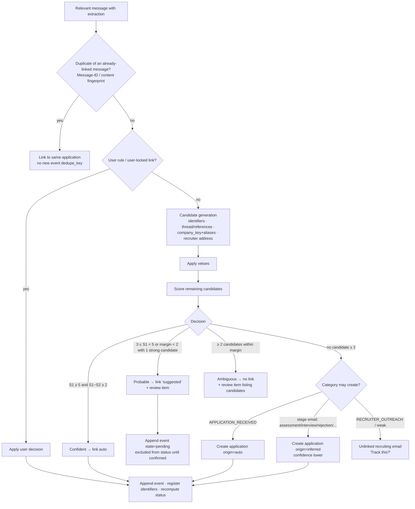
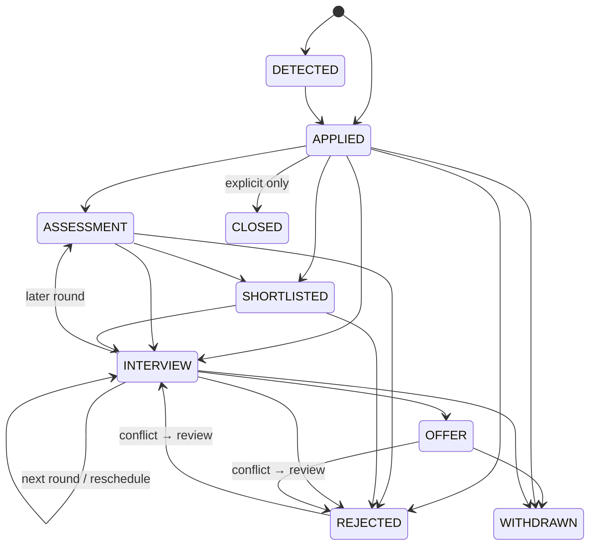

# 8–9. Application Matching Engine and Status Lifecycle

Labels: [F] fact checked on 2026-10-11 · [A] assumption · [D] decision.

---

## 8. Application matching

### 8.1 Framing

Matching is **per-user entity resolution**: grouping relevant emails into clusters, where each cluster is one application. Recommended approach [D]: **deterministic scoring with hard vetoes and margin-based abstention**, made explainable by storing every decision's feature breakdown.

**Principles:**
1. **Under-merging is better than over-merging.** A missed link costs the user one click to merge. A wrong merge corrupts history without anyone noticing.
2. **Identifiers decide first.** Thread and company+role come after.
3. **No single weak signal is ever enough.** A company match alone is never sufficient when the user has more than one open application there.
4. **User decisions are sticky.** The engine never rewrites a link or merge the user created or confirmed.
5. **Explainable.** Every outcome stores its candidates, features and score (`match_decisions`), which powers "Why is this email here?" in the UI.

### 8.2 Identifier and signal strength

| Signal | Scope | Strength | Notes |
|---|---|---|---|
| ATS application/candidate reference ID | user | **Decisive** (+10) | A unique identifier per application. |
| Job posting ID (from a canonical job URL) | user | Strong (+6) | The same posting re-applied to after rejection is a new application; see the re-application rule. |
| Requisition ID (with company) | user | Strong (+6) | Normalised together with `company_key`, since requisition formats collide across companies. |
| `In-Reply-To`/`References` → a message already linked | user | Strong (+5) | Real conversation threading. |
| Gmail thread ID (same account) | account | Medium (+3) | **Not decisive.** Gmail threads group by subject, so "Your application to Acme" for two roles can share a thread [A, observed behaviour]. |
| Same company_key (or alias) | user | Base (+2) | Required for any non-identifier match. |
| Role similarity (role_key) | — | 0 to +3 | Token Jaccard: ≥ 0.8 → +3; 0.5–0.8 → +1.5. Below 0.3 with both roles specific → **veto**. |
| Only open application at that company (singleton) | — | +2.5 | Within the last 180 days and not in a terminal state. |
| Same recruiter address (non-free-mail, or a free-mail address seen before on this application) | — | +1.5 | |
| Same platform/ATS tenant | — | +0.5 | |
| Plausible sequence (e.g. assessment after applied, within 0–60 days) | — | +1 | |
| Implausible gap (more than 180 days since last activity) | — | −2 | |
| Multiple open applications at the company and no role or ID in this email | — | −1 per extra candidate | Ambiguity penalty. |

### 8.3 Hard vetoes: a candidate is excluded outright

- Both sides have an ATS application ID and **they differ**.
- Both sides have a requisition ID or posting ID **and they differ**. The exception is when the user previously merged across them, recorded as an identifier alias.
- Both have a known `company_key`, the keys **differ, and they aren't aliases**.
- Both role keys are specific and similarity is below 0.3. A role is specific if it has at least 2 meaningful tokens, or 1 strong token such as "intern", "analyst" or "designer".
- Both employment types are known and conflict (internship vs full-time). The exception is a PPO/conversion phrase, which goes to review.
- **Re-application rule:** the candidate is terminal (`REJECTED`/`WITHDRAWN`/`CLOSED`), *and* the new email is `APPLICATION_RECEIVED` dated after the terminal event, *and* it carries no shared application ID. Then the candidate is vetoed, so a **new** application is created.
- The user explicitly separated this message from the candidate (a `user_rejected` link).

### 8.4 Algorithm



```text
match(msg, ext, user):                      // called under per-user advisory lock
  if dup = findDuplicate(user, msg.rfc822_id_hash, msg.content_fingerprint):
      return linkAs(dup.application, msg, 'auto', reason='duplicate')   // event dedupe absorbs it
  if rule = userRules.match(msg): return apply(rule)

  cands  = byIdentifiers(user, ext.ids)                       // UNIQUE(user,kind,value) lookups
         ∪ byReferences(user, msg.in_reply_to, msg.references)
         ∪ byThread(msg.account_id, msg.thread_id)
         ∪ byCompany(user, aliasesOf(ext.company_key), active_within=365d)
         ∪ byRecruiter(user, msg.sender_email) if sender is a person
  cands  = cands.filter(c => !vetoed(c, ext, msg))
  scored = cands.map(c => {app:c, score:Σ features(c, ext, msg), features})
  sort desc; S1, S2 = scored[0]?.score ?? 0, scored[1]?.score ?? 0

  decision =
    S1 ≥ T_CONF(5) and S1 − S2 ≥ MARGIN(2)            → CONFIDENT
    count(s ≥ 3 and S1 − s < MARGIN) ≥ 2              → AMBIGUOUS
    S1 ≥ T_PROB(3)                                    → PROBABLE
    category ∈ CREATES and ext.company known          → NEW (auto | inferred)
    category ∈ CREATES and company unknown            → NEW inferred + needs_review
    else                                              → UNLINKED

  persist match_decisions(msg, engine_version, decision, scored[0..4] with features)
  act(decision)
```

**Thresholds are initial values [A].** They are tuned on the corpus to hit pairwise precision ≥ 0.98. They are config with a version, not constants scattered through code.

**Why company is required for non-identifier matches.** Without a company, an email can only attach through identifiers, references, or the thread *with* role agreement. This prevents "Interview invitation" emails from unknown senders from attaching to whatever application happens to be recent.

### 8.5 Outcomes and their effects

| Outcome | Link state | Event effect | User-visible |
|---|---|---|---|
| Confident | `auto` | Event counts toward status | Normal timeline entry |
| Probable | `suggested` | Event stored with `pending=true`, **excluded from status** | Timeline shows "Possibly related, confirm?"; review item |
| Ambiguous | none | Event held on the message | Review item: "Which application is this?" with 2–4 candidates plus "New application" |
| New (auto) | `auto` | `APPLIED` event | New card |
| New (inferred) | `auto` | Stage event; application `origin=inferred`, `applied_at=null` | Card with an "Inferred" badge |
| Unlinked | none | none | "Other recruiting emails" list with "Track this" |
| Duplicate | `auto` (same app) | No new event (deduplicated) | Counted in "Sources: 2 accounts" |

Review items are **non-blocking**: the rest of the pipeline continues. An unanswered review item stays open. Probable links are not auto-confirmed after a timeout, which keeps the system conservative.

### 8.6 Worked examples

1. **LinkedIn Easy Apply, then a rejection through the company's ATS.**
   - The confirmation from LinkedIn creates application A: company Acme (from the body), role "SDE Intern", posting ID L123.
   - Three weeks later, a Greenhouse email says "Acme – Software Engineering Intern – Unfortunately…". There is no shared ID, so it is a candidate by company.
   - Score: company +2, role similarity 0.8 ("software development engineer intern" vs "software engineering intern", after abbreviation expansion) +3, singleton +2.5, plausible sequence +1 = **8.5**.
   - Result: confident, and status becomes Rejected.
2. **Two roles at the same company, an email without a role.**
   - A HackerRank invite says "Acme invites you to an assessment". The user has two open Acme applications: SDE Intern and Data Analyst Intern.
   - Each candidate scores company +2, no singleton bonus, ambiguity penalty −1, plausible +1 = 2.
   - Below the probable threshold but there are 2 candidates, so the result is **ambiguous**, with a review item: "Which Acme application is this assessment for?"
3. **The same email in two connected Gmail accounts** (CC'd to both, or a mailing list).
   - Same `Message-ID` hash, so the second copy is a duplicate.
   - Linked to the same application with no extra event. The timeline shows the source accounts.
4. **Placement-cell email forwarded from the college account to the personal account.**
   - The forward has a new Message-ID. The extractor strips the forward wrapper and computes the **content fingerprint over the original body**.
   - The fingerprint matches, so it's a duplicate. If the text was edited, the identifiers or company+role still match and the event `dedupe_key` (§9.4) absorbs it.
5. **A Gmail thread mixes two Acme roles.**
   - Thread +3 and company +2, but the roles conflict (Data Analyst vs SDE), so the candidate is vetoed.
   - Matching falls through to the other Acme application by role similarity.
6. **Re-applying to the same role in the next hiring cycle after a rejection.** The re-application veto applies, so a new application is created. Both appear separately in the UI, labelled with their dates.
7. **Interview invite from a recruiter's personal Gmail with only a first name and a company in the signature.**
   - Company from the signature (confidence 0.5), so the score is only moderate.
   - If it's the singleton open application at that company, it's probable and goes to review. Otherwise it's ambiguous.
   - The recruiter's address is learned for this application once the user confirms.

### 8.7 Deduplication layers (across accounts and repeated runs)

| Layer | Key | Catches |
|---|---|---|
| Ledger | `(mail_account_id, provider_message_id)` unique | Re-syncs; backfill and incremental overlap; retries |
| Cross-account message | per-user `rfc822_message_id_hash` | The same email delivered to several connected accounts |
| Content fingerprint | `sha256(normalised original body ‖ normalised subject ‖ sender domain)` | Forwards and re-sends with new Message-IDs |
| Event | `UNIQUE(application_id, dedupe_key)` | The same event reported by two different emails, e.g. LinkedIn and ATS both confirm the application |
| Application | identifier uniqueness `(user_id, kind, value)` | Two applications claiming the same ATS ID raise an `identifier_conflict` review ("Merge?") instead of silently coexisting |

Hashes use a per-deployment secret pepper (HMAC), so stored fingerprints can't be matched against outside data.

### 8.8 User corrections, and how the engine respects them

| Action | Implementation | Effect on future matching |
|---|---|---|
| **Merge** A into B | Move links, events and identifiers to B. A gets `merged_into_id=B` (a tombstone, kept for undo). Write `identifier_aliases` for any conflicting IDs. Add the company/role alias to the per-user tables. | Future emails with A's identifiers resolve to B. |
| **Split** selected emails out of A | Create C. Move the selected links and their events. Mark the moved links `user_confirmed`. Add `user_rejected` links (msg ↔ A) to block re-attachment. | The engine never re-links those messages to A. |
| **Move email** to another application | Same as split, onto an existing application. | Sticky. |
| **Confirm or reject a suggestion** | Link becomes `user_confirmed` or `user_rejected`. | The pending event is activated or removed. |
| **Edit company or role** | Update the application. Add the old value to per-user aliases. | Later emails using the old name still match. |
| **Not a job email** | Message becomes `user_irrelevant`. Optionally add an ignore-sender rule. | The message's events are removed; suppressed in future. |
| **Undo** | Every correction is a `user_corrections` row with before/after state. Undo replays the inverse. Available for 30 days. | — |

### 8.9 Re-matching after engine changes

- A new `engine_version` can be re-run over **non-user-locked** links for a user. The result is a **diff**, not an in-place rewrite:
  - Changes that keep or tighten grouping are applied.
  - Changes that **move** an already-confirmed (auto) link to another application become review items. Applications don't silently reshuffle.
- Re-matching always runs in chronological order under the user lock.

### 8.10 Why not ML for matching (yet)

- No training data can come from users [F]. Synthetic corpora are good for testing but are a weak training source for real-world matching.
- Deterministic scoring with stored feature vectors already has the form of a logistic model. Later, its weights can be **fitted by logistic regression on the synthetic and donor corpus**, without changing the engine's structure (phase 3 or later).
- An LLM for matching would add cost, latency and non-determinism to the step where errors are most expensive. It's rejected.

### 8.11 Matching metrics

- **Pairwise precision and recall** (B-cubed) against corpus clusters. Targets: precision ≥ 0.98, recall ≥ 0.90.
- **Duplicate application rate:** applications later merged by the user, divided by all applications. Measured in production as an aggregate count. Target ≤ 2%.
- **Wrong-merge rate:** splits by the user, divided by all applications. Target ≤ 1%.
- **Review rate:** review items per 100 relevant emails. Target ≤ 8. Above that, users stop reviewing.

---

## 9. Status and event lifecycle

### 9.1 Two different things

- **Events** are immutable facts with provenance: *on date X, email Y said Z*. Corrections are new events or link changes, never edits that overwrite history.
- **Current status** is a **deterministic projection** (a fold) over the application's *active* events. It is stored on `applications` for fast dashboard queries and recomputed in the same transaction as any event or link change.

### 9.2 Status set [D]

| Status | Meaning |
|---|---|
| `DETECTED` | Evidence of an application, but neither a confirmation nor a recognised stage (e.g. an inferred application from vague evidence). Replaces "Unknown". |
| `APPLIED` | Application received. |
| `ASSESSMENT` | An assessment was invited, pending or completed. |
| `SHORTLISTED` | Explicitly moved forward, with no specific next step yet. |
| `INTERVIEW` | An interview was scheduled or held. |
| `OFFER` | An offer was received (always confirmed by the user in the MVP). |
| `REJECTED` | Terminal. |
| `WITHDRAWN` | Terminal: the user or candidate withdrew. |
| `CLOSED` | Terminal: the posting closed or the user archived it. **Set explicitly only.** |

**Derived flags** (not statuses):
- `is_stale`: no activity for 45 days, configurable.
- `needs_review`.
- `has_upcoming`: a future interview or assessment deadline.
- `status_conflict`.

### 9.3 Event types and what they do to status

| Event | Kind | Implied status |
|---|---|---|
| `APPLIED` | stage | `APPLIED` |
| `ASSESSMENT_INVITED` | stage | `ASSESSMENT` |
| `ASSESSMENT_REMINDER` | modifier | — (updates the deadline) |
| `ASSESSMENT_COMPLETED` | modifier | — (stays `ASSESSMENT`; marks it completed) |
| `SHORTLISTED` | stage | `SHORTLISTED` |
| `INTERVIEW_SCHEDULED` | stage | `INTERVIEW` |
| `INTERVIEW_RESCHEDULED` | modifier | — (supersedes the time of the referenced interview event) |
| `INTERVIEW_CANCELLED` | modifier | — (removes the upcoming slot; flags review if no other stage follows) |
| `INFO_REQUESTED` | modifier | — (adds an action item) |
| `OFFER` | stage | `OFFER` |
| `REJECTED` | terminal | `REJECTED` |
| `WITHDRAWN` | terminal | `WITHDRAWN` |
| `CLOSED` | terminal | `CLOSED` |
| `MANUAL_STATUS` | user | The chosen status, with an optional `pin` |
| `NOTE` | user | — |

### 9.4 Projection rules

```text
project(app):
  evs = active events (link state ∈ {auto, user_confirmed}, not pending, not removed)
        sorted by (occurred_at, kind_priority, id)         // email date, NOT processing order
  if app.status_pinned: return pinned MANUAL_STATUS
  status = DETECTED; source = null; conflict = false
  for e in evs:
    if e.kind == modifier: apply side effects (upcoming slots, deadlines); continue
    if status ∈ TERMINAL and e.kind ∈ {stage}:
        conflict = true                 // e.g., interview invite after rejection (reopened? wrong match?)
    status, source = implied(e), e
  upcoming = future scheduled slots after reschedules/cancellations
  write applications.current_status, status_event_id=source.id, status_conflict=conflict,
        last_activity_at=max(occurred_at), has_upcoming, needs_review |= conflict
```

- **Out-of-order arrival is harmless.** Sorting by email date makes the result independent of processing order, which the backfill depends on. A property test checks this: any permutation of insert order gives the same projection.
- **Stage regression is allowed and is information.** For example, an assessment after an interview (another round). The status reflects the latest stage.
- **The non-linear cases from the brief:**
  - **Interview rescheduled:** a modifier pointing at the original interview event (`relates_to_event_id`). The upcoming time is updated. No new application, and no status change.
  - **Assessment reminder:** a modifier. It can't create an application because its category doesn't create applications (§7.5). If unmatched, it stays as an unlinked recruiting email.
  - **Rejection after an interview:** a normal terminal transition.
  - **Offer, then withdrawal:** becomes `WITHDRAWN`. The timeline keeps the offer.
  - **Offer, then rejection** (rescinded?), **or an interview after a rejection:** the latest event wins, `status_conflict=true`, and a review item asks "Is this the same application?", offering a split.
- **Event `dedupe_key`:**
  ```
  HMAC(event_type ‖ date_bucket(occurred_at or scheduled_at, 1 day) ‖ company_key ‖ role_key ‖ content_fingerprint?)
  ```
  The content fingerprint is included only when there's no scheduled time. Two different emails confirming the same application on the same day collapse into one `APPLIED` event; both stay linked as sources.
- **Manual status:** `MANUAL_STATUS` is a normal event in the fold. Later automatic events can supersede it, and the user is notified: "Updated to Rejected from an email on 14 Oct." With **pin**, the projection returns the manual status until it's unpinned. New events still appear in the timeline.

### 9.5 Typical transitions (descriptive, not enforced)



### 9.6 Traceability

Every status points to its source:

```
applications.status_event_id → application_events.source_message_id → source_messages
  (mail_account, provider_message_id, internal_date, subject, evidence snippet)
```

The UI shows something like: "**Rejected** · 14 Oct 2026 · from *no-reply@greenhouse.io* in *placements@college.edu* · 'Unfortunately, we will not be moving…' · [Open in Gmail] [Not right?]"

The Gmail deep link uses the message ID with `authuser=<address>`, so the correct account opens [A: verify the URL format during implementation].

---

## Implementation notes (task 6, 2026-10-11)

Built in `backend/src/server/applications/` (`matcher.ts`, `status.ts`, `queries.ts`). It runs inside the sync job once a mailbox's emails are all classified.

| Design | Built | Why |
|---|---|---|
| Review queue table with candidate lists | **Not yet.** Probable and ambiguous matches attach to the best candidate as `pending` events (shown, not counted toward status), and both the link and the application are flagged `needs_review`. | Nothing is lost or invented. The user sees "Possibly related". A proper "which application is this?" chooser comes with the corrections UI. |
| Merge, split, move, undo | **Not yet** | Next step, together with the "not a job email" and "wrong company" corrections. |
| Re-matching diffs on engine changes | **Full rebuild** (`resetApplications`) when `CLASSIFIER_VERSION` changes | There are no user edits to preserve yet. Must become a diff once corrections exist. |
| `CLOSED` status | Not produced. The UI shows a derived "No news for N days" (45+). | Matches §9.2: closed is never set automatically. |

Extra veto added from testing: a **second confirmation** at the same company with no clearly matching role starts a new application (under-merging).

**Tests:** `matcher.db.test.ts` covers 16 scenarios, including every §8.6 example that applies. `status.test.ts` covers the projection, including shuffled-order invariance. Mutation checks: removing the role veto fails 2 tests; removing the company veto fails 1 test (added after the first check found that gap).
